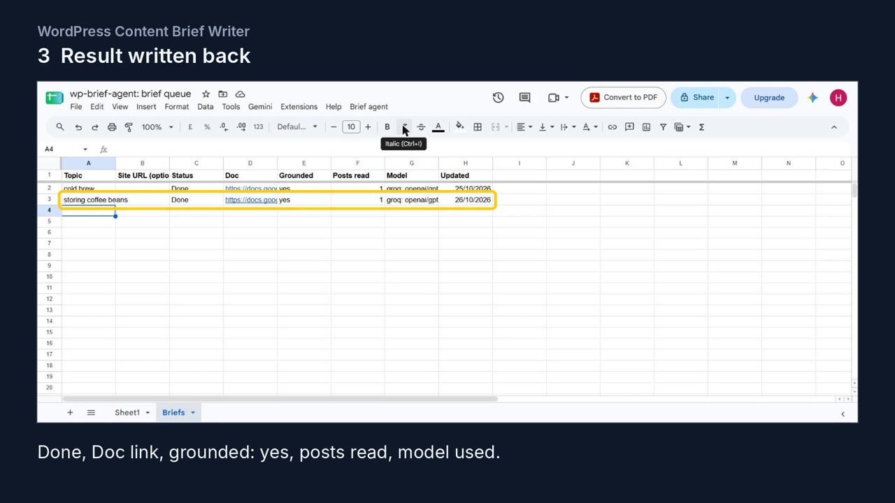
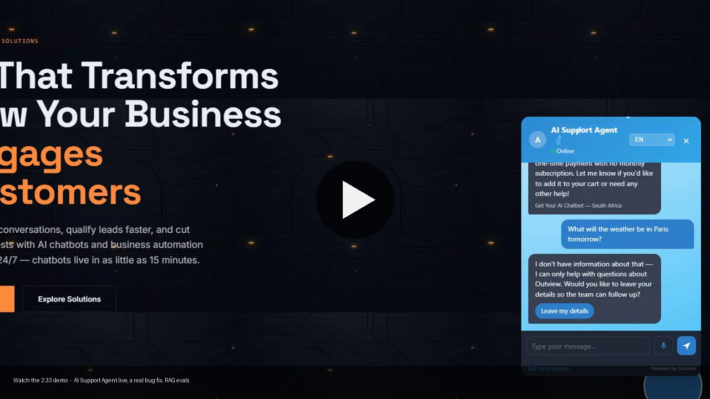

# AI demo — Henfred Pietersen

Two short videos. Both are narrated with an AI clone of my own voice (ElevenLabs); the script and the work shown are mine.

## 1. WordPress Content Brief Writer (1:29)

**[▶ Watch the demo (MP4, 1:29)](media/brief-writer-demo.mp4)**

A topic typed into a Google Sheet goes to a live LangGraph agent, which reads the WordPress site over its REST API and writes a content brief into Google Docs. The brief may only cite pages the agent read, and a final check enforces that. Recorded from a real run on 26 October 2026.

| Time | Scene | What you see |
|---|---|---|
| 0:00 | Title | |
| 0:03 | Add a topic | "storing coffee beans" typed into the Sheet |
| 0:16 | Run the agent | **Brief agent > Generate briefs for new rows**, then the script running |
| 0:28 | Result | The row filled in: Done, Doc link, Grounded: yes, 1 post read, Groq `openai/gpt-oss-120b` |
| 0:38 | The brief | Working title, angle, outline, posts to link, facts already on the site, gaps to fill, and the posts the agent read |
| 0:58 | Live API | The FastAPI docs page on Render: public `/demo`, token-protected `/brief` and `/brief/stream` |
| 1:12 | Code | [wordpress-content-brief-writer](https://github.com/henfredpietersen/wordpress-content-brief-writer) on GitHub |
| 1:24 | Links | |

The site in the demo is a fictional coffee roaster built for testing. Narration: [SCRIPT.md](SCRIPT.md#brief-writer-demo).

## 2. How I ship AI products (2:33)

A 2½-minute walkthrough of how I ship AI products: a live RAG chatbot, a real bug and its fix, and a Python RAG service with evaluation metrics and CI.

**[▶ Watch the demo (MP4, 2:33)](media/ai-demo.mp4)**

## How I work

I design the system, direct Claude to write the code, review what it produces, test it and ship it. I don't hand-code, and I can walk through every decision in the products shown. The narration is an AI clone of my own voice (ElevenLabs); the script and the work are mine.

## What's in the video

| Time | Scene | What you see |
|---|---|---|
| 0:00 | Intro | outview.co.za, where I sell the chatbot |
| 0:25 | Live chatbot | AI Support Agent answers a pricing question with a source link, then declines an off-topic question and offers to take the visitor's details |
| 1:12 | Where it broke | A real Team Inbox bug from the 0.22.9 release notes: what the symptom was, the cause, and the fix I specified |
| 1:48 | Evals | [policy-assistant](https://github.com/henfredpietersen/policy-assistant): retrieval Hit@1 0.80, MRR 0.83, 18 tests, Docker, green GitHub Actions run |
| 2:15 | Close | What I'm looking for and where to find my work |

Full narration: [SCRIPT.md](SCRIPT.md).

## A fix made for this demo

On the first take, the chatbot answered an off-topic question ("What will the weather be in Paris tomorrow?") by recommending competitor chatbots, and showed raw markdown. Rather than narrate over footage that contradicted the script, I fixed the product first, shipped it as v0.23.24–0.23.25, and re-recorded. Details in [CHATBOT-FIX.md](CHATBOT-FIX.md).

## Links

- Product: [outview.co.za](https://outview.co.za)
- GitHub: [github.com/henfredpietersen](https://github.com/henfredpietersen)

Looking for applied AI, solutions or implementation roles, remote in South Africa or internationally.
